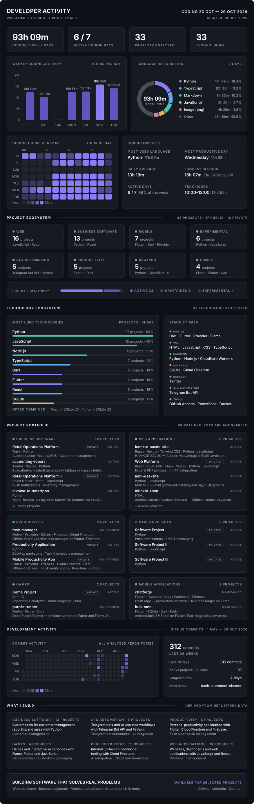

<!-- assets/terminal.svg and assets/profile.svg are regenerated by .github/workflows/developer-profile.yml -->
<p align="center">
  
</p>

<p align="center">
  <a href="https://www.linkedin.com/in/mukhammadabdulloh-tojiddinov"></a>
  <a href="https://t.me/m_tojiddinov7"></a>
  <a href="mailto:tojiddinov.sft@gmail.com"></a>
  
</p>

```console
linverno-tm@github ~ $ cat about.md
```

I build production-ready apps on two fronts: **Flutter** for mobile, **Next.js** for web — architecture before features, real security rules instead of "test mode", and offline-first data that survives slow connections.

```console
linverno-tm@github ~ $ ls ~/projects --featured
```

### 🏬 Hamkor CRM — installment-sales platform that replaces 1C
   

A retail chain of four stores ran on four separate 1C databases that couldn't see each other — a customer blacklisted in one store could get new credit in the next. I built one system for all of them: sales, installment contracts, payments, cash, warehouse, payroll and dozens of reports, with two-way sync to 1C while both run side by side.

- **Works without internet** — an encrypted local copy keeps every window usable offline; actions queue up and sync back when the line returns.
- **Windows app** on Tauri v2 with silent receipt printing, auto-updates through [public releases](https://github.com/linverno-tm/hamkor-nasiya/releases).
- **Every deploy is tested end-to-end** — sales, contracts, payments and reports run on a throw-away PostgreSQL before the build goes live.

`Next.js` `TypeScript` `PostgreSQL 16` `Tauri v2` `Service Worker` `Web Push` `1C sync`

### 🛡️ [Qalqon](https://github.com/linverno-tm/qalqon-yangilanish/releases) — Android shield against SMS stealers and malicious APKs
 

Scammers in Uzbekistan send fake APKs over Telegram that steal SMS codes. Qalqon checks every installed app for the stealer pattern — SMS and notification access, Accessibility, device admin, hidden icon, sideloaded installer chain — and scans an APK *before* it is installed, straight from Telegram's "Open with". Built for elderly users: large type, plain Uzbek, Latin ↔ Cyrillic switch.

- Binary manifest and DEX parsing in pure Dart, on a background isolate; APKs are streamed in chunks, so it runs on old phones.

`Flutter` `Kotlin` `APK / DEX analysis` `Isolates`

### 🌐 [HAMKOR SAVDO](https://github.com/linverno-tm/hamkor-savdo-site) — brand site + live competitor price watch
A story page plus a page per branch for the same retail chain — Next.js 16, React 19, Tailwind v4, no animation library. Next to it runs a **price watch**: competitors' posts in Telegram groups become prices in real time, and a daily PDF per shop carries only the new or changed prices.

`Next.js 16` `React 19` `Tailwind v4` `Telegram` `PDF reports`

### 👷 [Workforce OS](https://github.com/linverno-tm/workforce-os) — attendance and sales-based payroll at the edge
Attendance, uniforms and payroll calculated from each employee's sales — running entirely on Cloudflare Workers with D1. Custom JWT sessions in HttpOnly cookies, PBKDF2-SHA256 password hashing via Web Crypto.

`Next.js 16` `Cloudflare Workers` `D1` `Server Actions` `JWT`

### ✨ Websites — live demos
- **[BON! Café](https://linverno-tm.github.io/bon-cafe-landing/)** — trilingual cinematic landing page pitch.
- **[MINI GES](https://linverno-tm.github.io/mini-ges-site/)** — site for small hydro-power plants (Ulug'nor, Baliqchi).
- **[Shuxrat o'g'li](https://linverno-tm.github.io/shuxrat-ogli-site/)** — brand site concept for a poultry producer, in Uzbek, Russian and English.

### 🧾 Accounting automation
- **[accounting-report](https://github.com/linverno-tm/accounting-report)** — builds the tax-audit (kameral) report from invoices and cash receipts.
- **[invoice-to-smartpos](https://github.com/linverno-tm/invoice-to-smartpos)** — turns e-invoice `.xls` files into a SmartPOS product list.
- **[bank-statement-cleaner](https://github.com/linverno-tm/bank-statement-cleaner)** — cleans and normalizes bank statements for the books.

<sub>Earlier Flutter work: [ChatForge](https://github.com/linverno-tm/chatforge) · [Task Manager](https://github.com/linverno-tm/task-manager) · [Deep Purple Runner](https://github.com/linverno-tm/purple-runner) · [Bulk SMS](https://github.com/linverno-tm/bulk-sms)</sub>

```console
linverno-tm@github ~ $ cat principles.txt
```

- **Architecture first** — feature-first folders, repositories separated from UI, providers wired explicitly.
- **Offline is a requirement, not a feature** — local persistence plus a sync layer that survives bad networks.
- **Security at the backend, not the client** — ownership-scoped rules, server-side validation, no insecure defaults.
- **No invented data** — if a value isn't confirmed, the field stays empty and the UI says so.
- **Native when it matters** — MethodChannel + foreground services when Dart alone can't do the job.
- **Ship-ready** — CI on every push, static analysis clean, no warnings left behind.

```console
linverno-tm@github ~ $ ./activity.sh --full
```

<details>
<summary><b>Open the full developer dashboard</b> — WakaTime coding activity and analysis of every repository (private ones anonymized), updated automatically</summary>
<br>

</details>

<p align="center"><sub>Open to remote roles and selected projects — <a href="https://t.me/m_tojiddinov7">say hi</a>.</sub></p>
